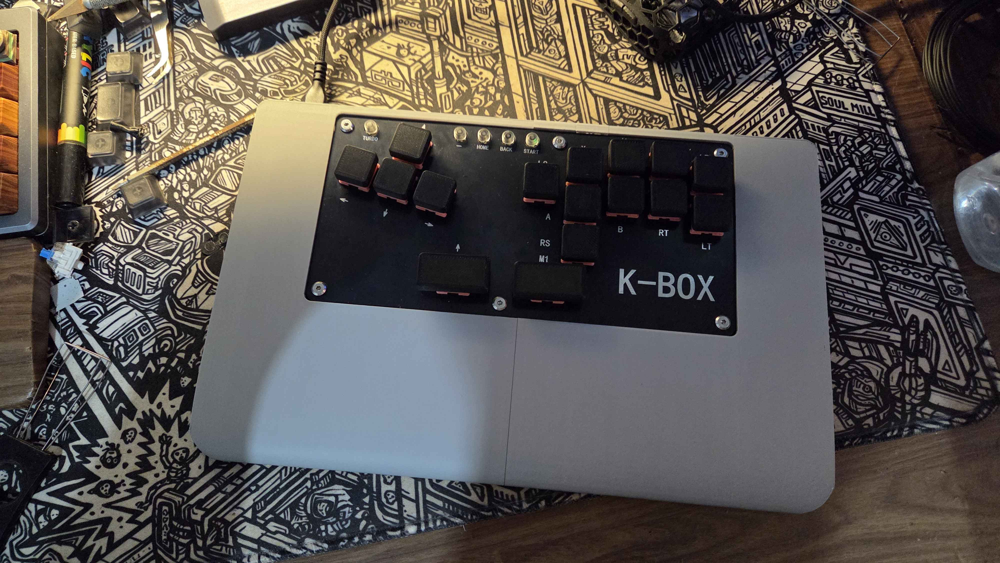
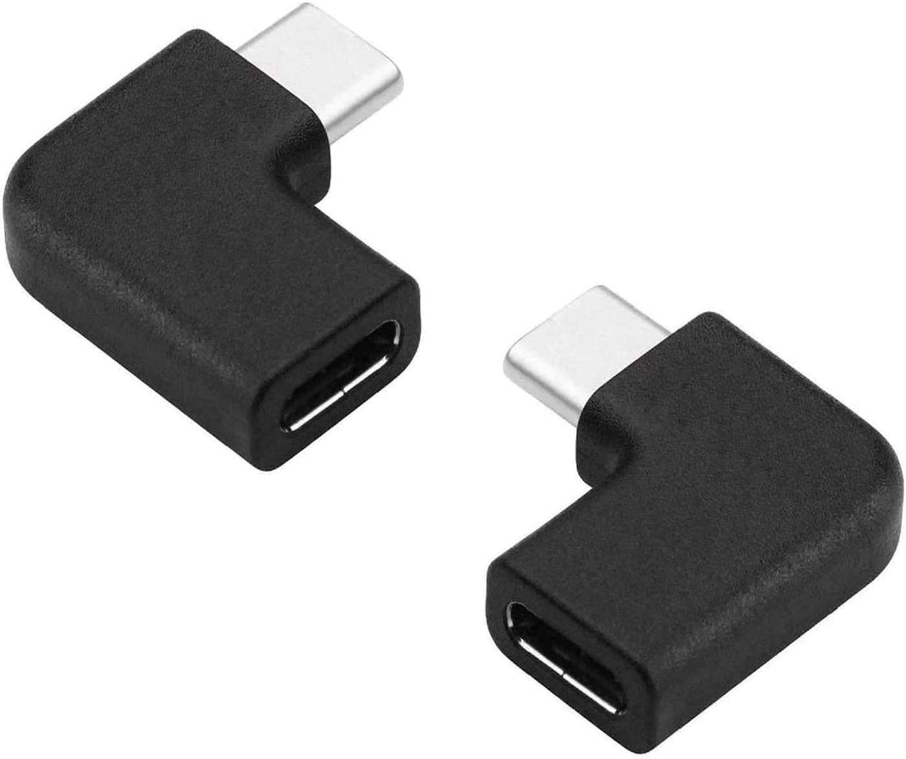
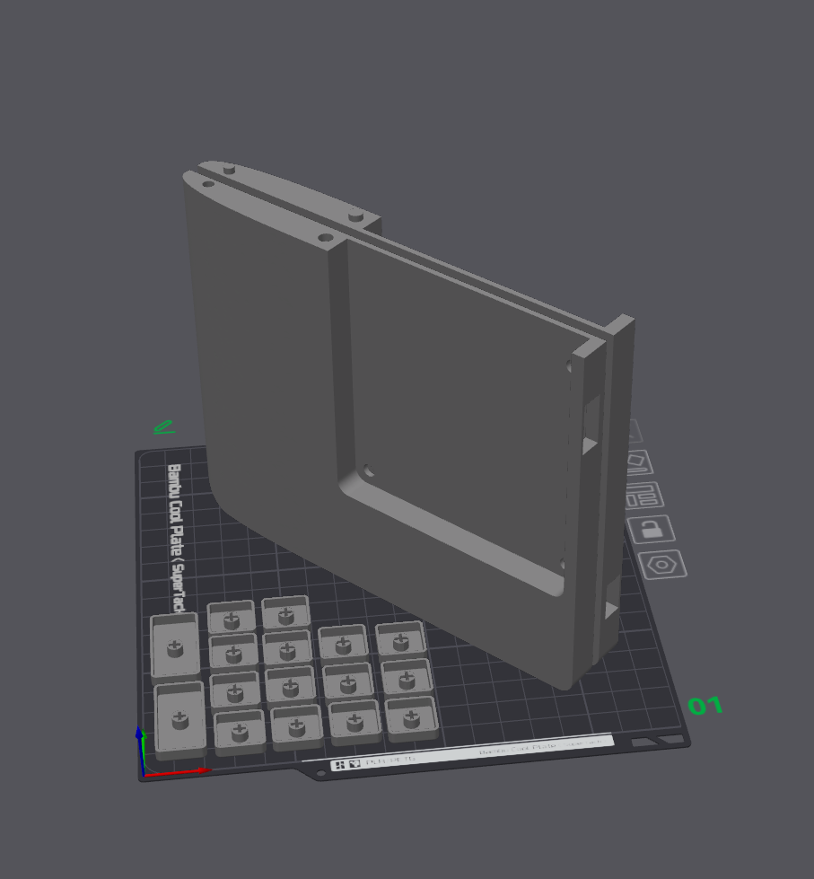
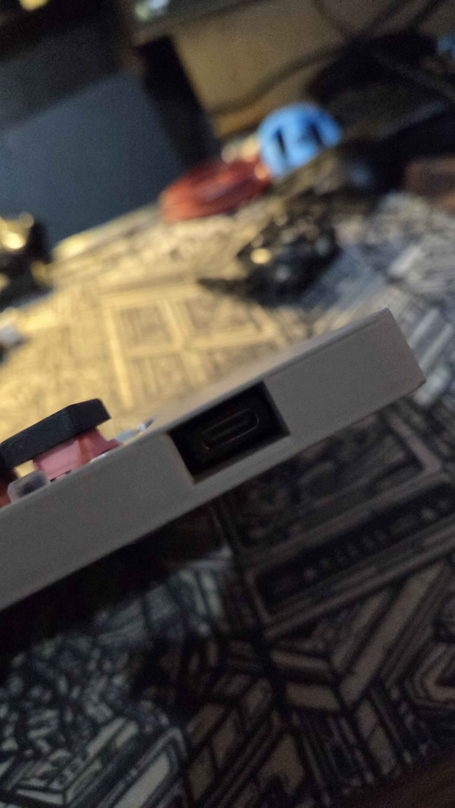
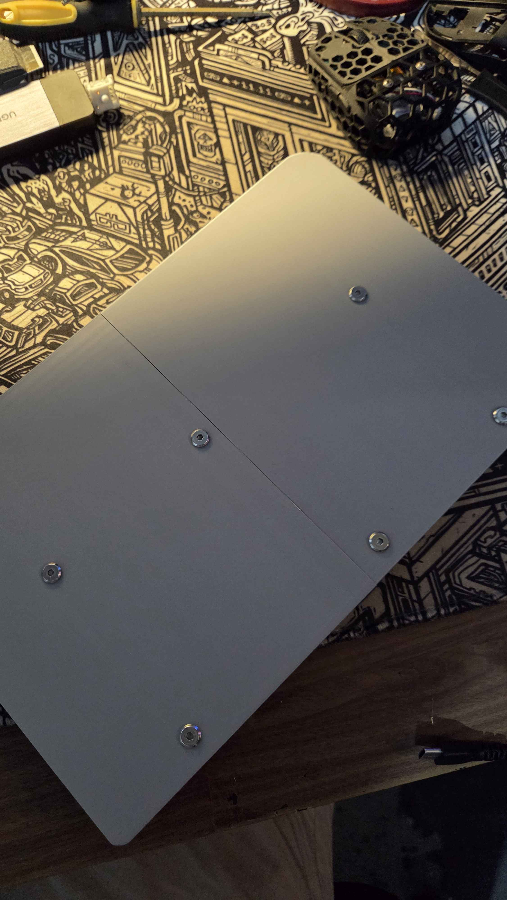

<!-- ABOUT THE PROJECT -->

## Haute42 B6 Extension Board & Keycaps

This is a mod for the Haute42 B16 Extension that gives the board a space for your lap and wristrests, as well as low profile keycaps to use. The design also includes a slot on the side to store your usb to type c converter. Very sturdy, no wobble.

**NOTE:**
There are 2 versions of this design, one with and without 90 degree Type C Adapter. This just makes the board a lot cleaner and nicer having the port on top instead of the side. I got mine for exactly a dollar.

### Print Instructions:

Fits printers A1 Mini and Above. Print with side on the plate standing up. This ensures smoothness on the curves and a super clean looking board. Keycaps laying upside down, I suggest using a spare switch to loosen the fit before putting it onto the board.

### Assembly:

<ul>
    <li> Remove the screws of the Haute42 B16 and remove the backmost plate </li>
    <li> (If you got an adapter) Connect the Adapter and slide in the Haute42 B16 Board on the left side </li>
    <li> Slide in the right side to the Board and Push tight. </li>
    <li> Put the Screws Back in </li>
    <li> (Optional) put your USB to Type C adapter on the slot in the left Side </li>
</ul>

<!-- LICENSE -->
## License

Distributed under the CC0-1.0 License. My work is free for anyone to do what they please. See `LICENSE.txt` for more information.

<!-- CONTACT -->
## Suggestions

For any requests or suggestions, SlayCC on Discord or u/SlayCC on reddit.

Project Link: [https://github.com/SlayCC/Fingertip-Mouse-Mods](https://github.com/SlayCC/Haute42-B16-Extender)

(<a href="#readme-top">back to top</a>)
